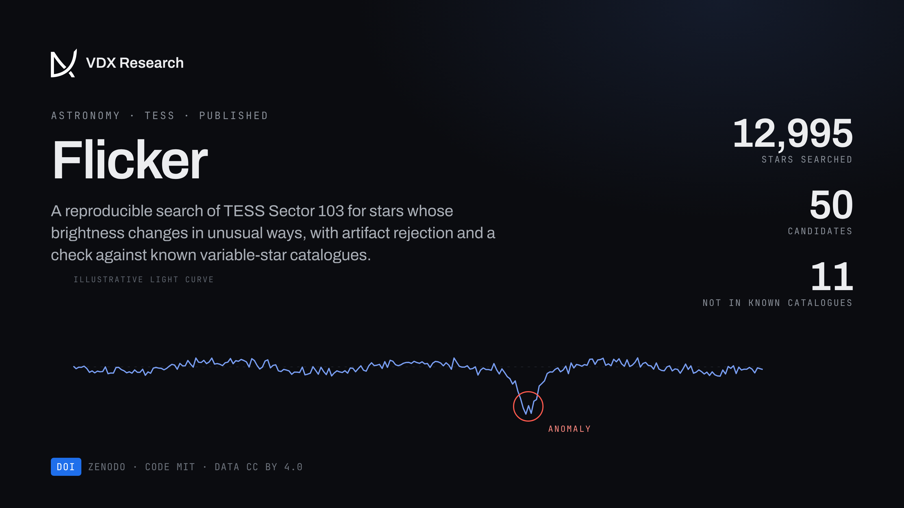
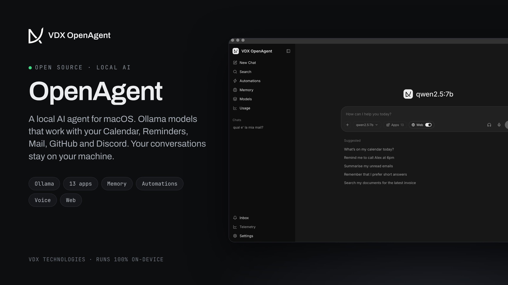

<h3>Hey, I'm Filippo 👋</h3>

Building <b>VDX Technologies</b> — optical communication and open research from Friuli, Italy.

  <a href="https://vdxtechnologies.com">Website</a> ·
  <a href="https://linkedin.com/in/TUO-PROFILO">LinkedIn</a> ·
  <a href="https://x.com/TUO-PROFILO">X</a>

<table>
  <tr>
    <td width="50%"> <b>LL-01</b> — laser link with automatic pointing & tracking</td>
    <td width="50%"> <b>Flicker</b> — anomaly search in TESS light curves (DOI)</td>
  </tr>
  <tr>
    <td width="50%"> <b>OpenAgent</b> — local AI agent for macOS</td>
  </tr>
</table>

<h4>languages</h4>

<h4>frontend</h4>

<h4>hardware</h4>

<h4>infra</h4>

